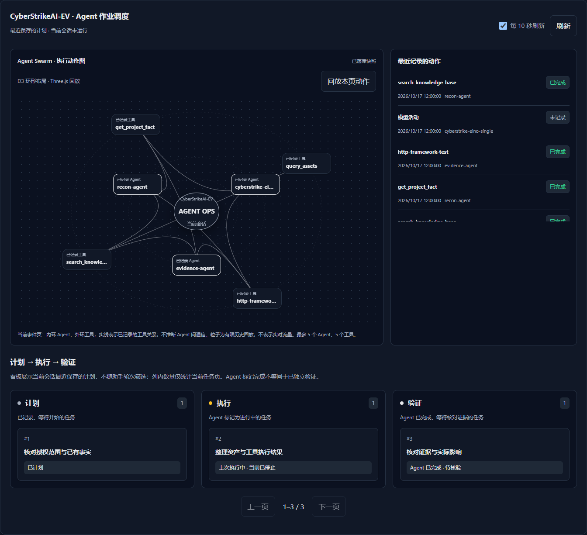

# AI execution view

[中文](../zh-CN/execution-view.md)

Open **AI execution** in the sidebar and select an accessible conversation. The default **Task board** has Plan, Execute and Verify lanes populated from saved TaskCreate/TaskUpdate records. Pending tasks appear under Plan, in-progress tasks under Execute, and Agent-completed tasks under Verify with an explicit **awaiting verification** label. This is a read-only board: no drag operation changes task state, and Agent completion never establishes independent verification. Expand a card to read its recorded description, assignee and dependencies.

Above the lanes, **Agent Swarm** shows Agents on the inner ring and tools on the outer ring, with a recent-action feed. Links come only from recorded Agent/tool metadata in the selected turn's current event page, not inferred delegation, inter-agent messages or target reachability. At most five Agents and five tools are drawn. Click a node to filter the feed; use All events to clear it. The feed contains up to eight recent records from that page. All styles follow the application's light/dark theme.

**Replay page actions** starts an eight-second Three.js particle replay: a call moves from Agent to tool, a result moves back. Each particle represents one recorded call/result (at most 50); this is historical replay, not live network traffic or token throughput. D3 supplies deterministic radial spacing. Replay stops on navigation, hidden tabs, switching to timeline, reduced-motion preference or narrow screens. GPU resources are disposed on view replacement. Mobile and unavailable WebGL/dependencies retain the static graph, keyboard-accessible nodes and action feed.

Pinned D3 7.9.0 and Three.js 0.186.1 assets, licenses and a SHA-256 manifest are included under `web/static/vendor/swarm/` and loaded only when a populated desktop graph needs them. There is no CDN or new Python/model service. This remains an Eino application: [AutoGen messages](https://microsoft.github.io/autogen/stable/reference/python/autogen_agentchat.messages.html) distinguish observable events from messages, while [MASFactory](https://github.com/BUPT-GAMMA/MASFactory) supplies its own graph runtime. Neither runtime is required to project Eino's existing persisted events. Unrecorded Agent-to-Agent messages are not synthesized.

The board reads the conversation's latest saved plan, independently of the selected assistant turn used by the relationship graph and timeline. Plans remain visible when a conversation stops; an in-progress card from a stopped conversation is explicitly marked stopped. This is not a historical plan snapshot for a selected turn. Task pages contain at most 50 cards, and lane counts describe that page.

Switch to **Action timeline** to choose an assistant turn and see persisted status, iteration count, tool count, tool issues and recorded duration.

The timeline shows model activity, tool actions and coordination/approval events. A tool's result may be outside the selected page: its status is reconciled against the persisted tool execution summary. Unknown and missing results remain explicit. The view never executes tools or changes approval decisions.

## History and refresh

- Conversations are searched in pages of 25. The turn selector reads 20 messages at a time; **Earlier turns** loads the next older batch. **Latest turns** returns to its newest turns.
- Event pages contain at most 50 records. Filters apply to the current event page; overview counts describe the selected turn.
- An active turn or running conversation board refreshes every ten seconds. Turn off automatic refresh to inspect a static snapshot. Inactive views stop polling; use Refresh to read again.
- Reads are serialized and canceled on conversation changes, navigation and hidden tabs. Refresh waits for the preceding read and backs off after errors. Three consecutive failed reads pause automatic refresh until an explicit Refresh.
- Transient failures retain the last successful snapshot and show a failure notice. Authentication, permission or unavailable-resource responses clear displayed execution records.
- `#execution-view?conversation=<id>` opens a conversation using the same access checks as chat. API errors do not expose raw upstream messages in this page.

## Access and data boundaries

The page requires `chat:read`. Conversation lists and message/process-detail reads use the existing authenticated conversation APIs and resource-scope checks. The page introduces no alternate privileged endpoint or database.

The timeline renders event metadata: event class, tool/agent name, time, recorded iteration and persisted status. It does not display reasoning text, tool arguments, raw outputs or arbitrary event messages. The board separately renders explicitly saved task descriptions. Use the original conversation for detailed evidence. Missing task or event records display an empty state rather than invented steps. No model/provider requests are made by opening this view.

## Saved-board API

`GET /api/conversations/{id}/plan-tasks?snapshot=latest&limit=50&offset=0` returns the latest saved conversation plan, including stopped conversations. Authentication and `chat:read` with conversation-resource access are required. `limit` must be 1–100; `offset` must be nonnegative. The response contains `tasks`, `total`, `completed`, `activeStep`, `running`, `snapshot`, `limit` and `offset`. Example: `{"tasks":[],"total":0,"completed":0,"activeStep":0,"running":false,"snapshot":"latest","limit":50,"offset":0}`. Invalid pagination or snapshot returns 400; missing login returns 401; inaccessible conversations return 403; unavailable records return 404; storage failures return 500. Omitting `snapshot` preserves the chat page's live-only behavior.

The same server endpoint and static frontend support Windows and Linux. No native command, process-isolation or service-startup behavior changes. Deploy the matching server, HTML, JavaScript, CSS and locale resources after active work finishes; roll them back together if needed. No schema migration or new runtime configuration is required.

## Validation

```sh
node --test tests/web/*.test.cjs tests/web/*.test.mjs web/static/js/*.test.cjs
node tests/browser/execution-view.cjs
```

The browser fixture needs Playwright and an installed Chromium browser. `EXECUTION_BROWSER_CHANNEL=chrome` optionally uses an installed Chrome for local validation. Set `EXECUTION_VIEW_SCREENSHOTS` to capture fixtures. CI runs the default bundled Chromium on Linux. Tests use synthetic records and no external targets or providers.


